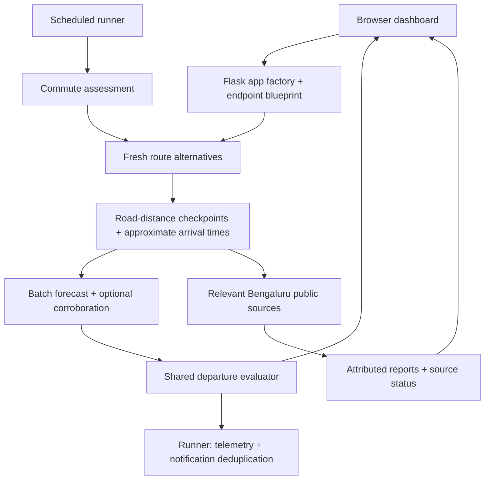

# Architecture

Dry Socks is a local commute assistant with two entry points: a Flask dashboard
for on-demand checks and a Python runner for scheduled checks. Both use the same
route sampling, weather parsing and departure evaluator. The frontend uses
ordinary scripts and CSS; there is no build step or database.

## Reading order

1. `server.py` creates the app, applies local HTTP protections and starts Flask.
2. `services/dashboard.py` validates HTTP input and delegates to service adapters.
3. `services/commute.py` builds the shared weather response and runner assessment.
4. `services/routing.py` fetches alternatives, samples road distance and matches
   the user's saved route preference to fresh alternatives.
5. `services/weather.py` parses coverage, timestamps and rainfall; `evaluator.py`
   turns those values and checkpoint arrival times into cautious guidance.
6. `web/app.js` owns browser state, search sessions, user events and result views.
   `web/api.js` owns HTTP cancellation/timeouts; `web/map.js` owns map providers
   and overlays. `theme.js` and `ambient.js` are independent visual enhancements.

## Contracts and data flow

Coordinates use `{name, lat, lon}`. Geometry uses GeoJSON `LineString` coordinates
in `[longitude, latitude]` order. A route includes geometry, `duration_mins`,
`distance_km`, `waypoints`, provider attribution and whether its ETA is traffic-aware.
Weather checkpoints include an approximate `eta_mins`, forecast coverage and
`mins_to_rain`: `null` means unavailable; `999` means no signal within the available
horizon. Forecast timestamps are UTC; the browser and scheduling use Asia/Kolkata.

Saving stores endpoints, travel mode and a preferred shape. The runner retrieves
fresh alternatives and ETAs rather than treating a saved ETA as current. Reverse
commutes use a new route choice. A saved shape expresses a preference; providers
can return different alternatives later.

| Endpoint | Purpose |
| --- | --- |
| `GET /api/config` | Public settings and credential-presence flags; private keys are omitted |
| `POST /api/config` | Validate and atomically save endpoints, mode and route preference |
| `GET /api/search`, `/api/place`, `/api/reverse` | Autocomplete, selected details and map-point naming |
| `POST /api/routes` | Fresh route alternatives for endpoints and mode |
| `POST /api/weather` | Forecast checkpoints, coverage and shared departure advice |
| `POST /api/btp` | Relevant attributed public reports and source availability |
| `POST /api/waterlogging` | Retired endpoint, returns 410; rainfall risk lives in weather |

## Reliability boundaries

Missing weather remains explicit and cannot produce a clear-weather claim.
Tomorrow.io can strengthen a warning but cannot erase an Open-Meteo signal.
Recent accumulated rain indicates susceptibility, not observed flooding. X
reports remain contextual text with original links; they do not become fabricated
traffic delays or confirmed route incidents.

Weather and social requests are independent in the browser. Request cancellation
plus version checks keep delayed results from overwriting a new route or edit.
Editing a commute clears old advice and map overlays. Browser search fields own
separate Google autocomplete sessions; details are fetched only after selection.

Each Flask app owns its configuration path, lock and demo state. Writes reject
cross-origin requests; all HTTP access requires a localhost host. The server
binds to loopback and runs without debug mode. This is a local trust boundary,
not an authenticated multi-user service.

## Explicit demo boundary

`--demo` selects `services/demo.py` at startup. It never reads local configuration
or credentials and never calls providers. Synthetic corridors and forecasts use
the same HTTP contracts and evaluator as live mode. Saves remain in that app's
memory until restart. X is disabled. Leaflet draws the synthetic corridors without
external road tiles. Live Google content is displayed only on Google Maps; when
the browser map is unavailable, text search and results remain usable.

## Persistence and dependencies

Live settings are stored in ignored `config.json`, with atomic replacement and
environment overrides. The monitor appends to ignored `telemetry.csv` and keeps
notification history in `~/.varuna_state.json`. The older state and LaunchAgent
names remain for compatibility with existing installations.

The core depends on Flask, requests and polyline. Playwright/Chromium are optional
for cookie-based X access and browser verification. The demo uses bundled map
assets and local scenery. CSS loads base components, themes and responsive rules
in that order. No cloud service is needed to explore the demo.
